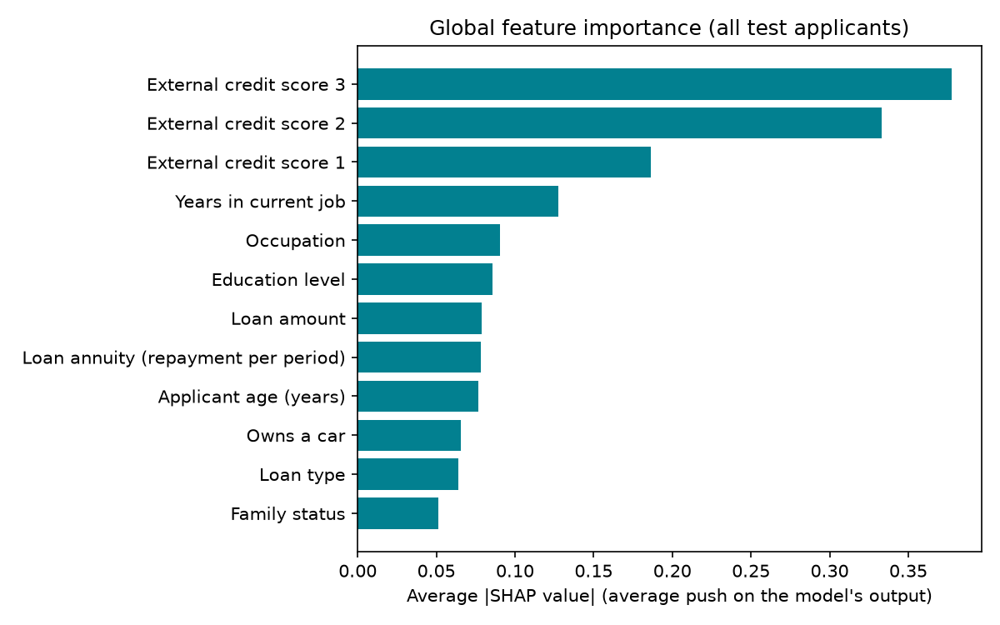

# Trustworthy Credit Explanations

Do LLM-written explanations of credit-risk decisions actually reflect what the model used? This project trains a credit default model, computes SHAP values as ground truth, asks an LLM to explain flagged applicants under three evidence conditions, and scores how faithful each explanation is.

## Pipeline

1. **Model**: LightGBM default-risk classifier on the [Home Credit](https://www.kaggle.com/c/home-credit-default-risk) `application_train.csv` data (test AUC ≈ 0.75).
2. **Ground truth**: SHAP values for every unseen test applicant.
3. **Explanations**: an LLM (Groq) explains 300 flagged applicants under three prompt conditions, identical except for the evidence block:
   - `none`: no evidence
   - `global`: global feature importance ranking
   - `applicant-level`: the applicant's own SHAP values
4. **Faithfulness metrics**: top-3 feature overlap with SHAP, sign (direction) accuracy, and count of invented features.
5. **Statistics and dashboard**: hypothesis tests and a Power BI dashboard.

## Results

Scored on 300 flagged test applicants, each explained under all three evidence conditions (900 explanations). Higher is better for overlap and sign accuracy.

| Evidence given to the LLM | Top-3 overlap with SHAP | Sign accuracy | Invented features |
|---|---|---|---|
| `none` | 0.35 | 0.75 | 0 |
| `global` | 0.63 | 0.89 | 0 |
| `applicant-level` | 1.00 | 1.00 | 0 |

**Key findings**

- Without evidence, the LLM names the model's true top-3 drivers only about a third of the time (0.35). Random guessing among the 25 features would score about 0.12.
- Adding global feature importance raises overlap to 0.63 and sign accuracy to 0.89.
- Giving the LLM the applicant's own SHAP values gives perfect scores. This is expected, since the prompt contains the ground truth, so treat it as a ceiling rather than a surprising result.
- All three pairwise gains in overlap are significant (Wilcoxon signed-rank, Bonferroni-corrected α = 0.05/3): none → global +0.29, global → applicant-level +0.37, none → applicant-level +0.65. Full test output is in `outputs/tables/hypothesis_results.csv`.
- No condition invented a feature name outside the allowed feature list.

**Model:** LightGBM, test AUC 0.753. The top 10% of test applicants by predicted risk are flagged, and 27% of flagged applicants default versus 8% overall.



<!-- Optional: add a Power BI dashboard screenshot here, e.g.  -->

See [`outputs/README.md`](outputs/README.md) for a guide to every output file.

## Repo structure

```
src/        pipeline code (data prep, EDA, training, SHAP, prompts, LLM client, metrics, hypotheses)
configs/    config.yaml (seed, split, number of applicants, LLM settings)
outputs/    figures, tables, model metrics, Power BI CSVs, cached LLM responses
*.pbix      Power BI dashboard (+ exported .html version)
```

## Setup

```bash
pip install -r requirements.txt
pip install groq                      # or swap the client in src/llm_client.py
export GROQ_API_KEY="your-key"
```

Download `application_train.csv` from Kaggle into `data/raw/`.

## Run

```bash
python -m src.eda
python -m src.train_model
python -m src.compute_shap
python -m src.export_for_powerbi
python -m src.generate_explanations --limit 10   # pilot; omit --limit for all 300
python -m src.hypotheses
python -m src.named_feature_counts
```

LLM responses are cached in `outputs/llm_cache/`, so reruns don't repeat API calls.

## Notes

- Only `src/llm_client.py` depends on the LLM provider.
- `src/mock_explanations.py` produces fake data for dashboard layout testing only.
